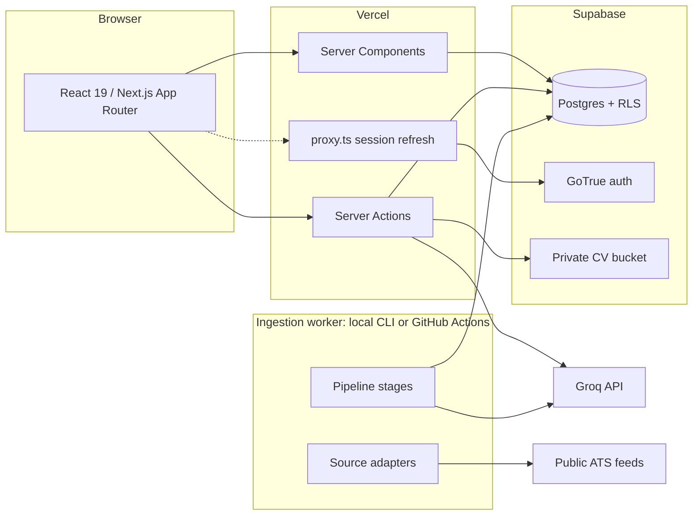
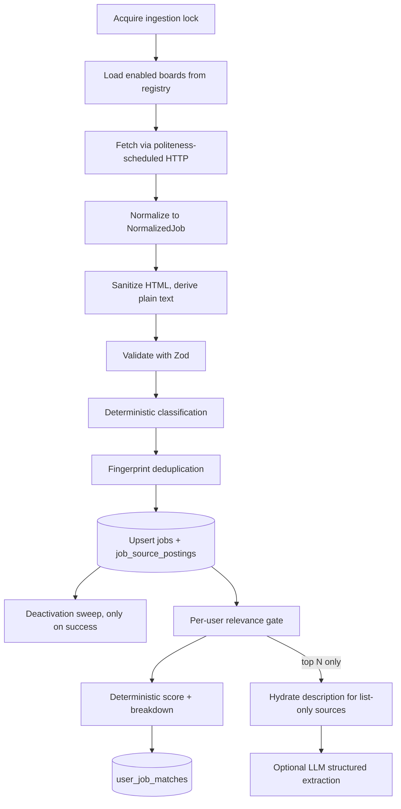

# Architecture

An AI-assisted job discovery platform for German technology jobs. It ingests postings
from public ATS feeds, scores them against the user's CV with a transparent
deterministic engine, and uses an LLM only to explain results and draft documents.

- [1. System overview](#1-system-overview)
- [2. Layering rules](#2-layering-rules)
- [3. Data flow](#3-data-flow)
- [4. Ingestion pipeline](#4-ingestion-pipeline)
- [5. AI layer](#5-ai-layer)
- [6. Matching layer](#6-matching-layer)
- [7. Storage](#7-storage)
- [8. Authentication](#8-authentication)
- [9. Deployment](#9-deployment)
- [10. Security model](#10-security-model)
- [11. Observability](#11-observability)

## 1. System overview

Three deployable units, one codebase.



The web app never runs ingestion, and the worker never imports Next.js. They share
only the pure domain layer and the generated database types.

## 2. Layering rules

The single most important structural rule in this codebase:

> `src/lib/core/**` is pure TypeScript. It may not import Next.js, React, Supabase,
> or any I/O library.

`core` holds the taxonomy, normalizers, deduplication, and the scoring engine — the
logic that is both the most valuable and the most testable. Keeping it free of
framework and I/O dependencies means:

- it is unit-testable without mocks, a database, or a rendering environment;
- the ingestion worker can move to Railway, Render, Fly, or a queue consumer by
  changing only its entrypoint;
- the same scoring code runs identically in the worker and in a server action.

This is enforced mechanically by an ESLint `no-restricted-imports` override scoped to
`src/lib/core/**`, so a violation fails lint rather than relying on discipline.

The dependency direction is strictly one-way:

```
app / components  ->  server  ->  lib/{ai,sources,ingestion,resume,supabase}  ->  lib/core
```

Nothing in `lib/core` imports from anything above it.

## 3. Data flow

### Onboarding and CV

1. User signs up; Supabase Auth sends a verification email.
2. A database trigger creates a `profiles` row keyed to `auth.users.id`.
3. Onboarding collects profile and preference data, then stamps
   `profiles.onboarding_completed_at`.
4. CV upload writes to a **private** Storage bucket under `{user_id}/{uuid}.{ext}`.
5. Text is extracted server-side (`unpdf` for PDF, `mammoth` for DOCX).
6. The AI layer parses that text into a Zod-validated structure stored on
   `resume_versions.parsed`.
7. The user reviews and corrects the extraction. Corrections are written to a
   **separate** `user_edited` column so that re-parsing never destroys them. All
   downstream consumers read `coalesce(user_edited, parsed)`.

### Job discovery

Ingestion writes canonical jobs. The web app reads them, filtered by RLS, and never
computes scores or calls an LLM during page render.

## 4. Ingestion pipeline



### The adapter port

Sources fall into two classes, which the interface has to accommodate:

- **Single-shot** sources return descriptions in the list response (Arbeitnow,
  Greenhouse with `content=true`, Ashby, Lever, Recruitee, Personio).
- **List-then-detail** sources return a list without descriptions and require one
  extra request per posting (SmartRecruiters, Bundesagentur).

A single `fetchJobs()` would force list-then-detail sources to pay N requests before
knowing whether any posting is even relevant. So `hydrate` is a separate, optional
step invoked only after the relevance gate:

```ts
interface JobSourceAdapter {
  readonly name: JobSourceName;
  readonly kind: 'aggregator' | 'ats_board';
  readonly requiresBoardToken: boolean;
  listJobs(ctx: SourceContext, opts: JobFetchOptions): AsyncIterable<RawJobStub>;
  hydrate?(ctx: SourceContext, stub: RawJobStub): Promise<RawJobStub>;
  normalize(stub: RawJobStub): NormalizedJob;
}
```

`normalize` is pure and lives beside the adapter so it can be unit-tested against
recorded fixtures with no network access.

### Politeness scheduling

Every source we verified is throttled in some way: Arbeitnow returns 429 around page
19, Personio serves bot-protection responses to parallel tenant fetches, Ashby
rate-limits per IP and documents itself as unsuitable for high-volume polling, and
Greenhouse throttles aggressive polling without publishing a limit.

`src/lib/sources/http.ts` therefore provides more than a timeout wrapper:

- a token-bucket limiter keyed by hostname, so requests serialize within a host but
  run concurrently across hosts;
- exponential backoff with jitter on 429/503, honouring `Retry-After`;
- detection of bot-protection HTML returned with a 200 status;
- a response size cap and a redirect limit;
- an allowlist of permitted hosts, so a compromised registry row cannot turn the
  worker into an SSRF vector.

Because ingestion is slow by necessity, the pipeline is incremental and resumable:
progress is recorded per board, and a run that dies mid-way does not lose work.

### Locking

Overlapping runs must never happen. A Postgres advisory lock is unsuitable because
GitHub Actions talks to Supabase over HTTP with no persistent session, so the lock is
a row in `ingestion_locks` acquired by a conditional update on `locked_until`. A
GitHub Actions `concurrency` group provides a second, independent guard.

## 5. AI layer

### The port

```ts
interface AIProvider {
  parseResume(input): Promise<ResumeParseResult>;
  parseJob(input): Promise<JobAnalysis>;
  explainMatch(input): Promise<MatchExplanation>;
  generateCoverLetter(input): Promise<CoverLetter>;
  suggestResumeImprovements(input): Promise<ResumeSuggestions>;
}
```

Implemented over the Vercel AI SDK, so swapping Groq for Ollama is a change in the
model factory rather than in any task. Every model identifier comes from `env.ts`;
no model string appears anywhere else in the codebase.

### Structured output

All tasks use `generateText` with `Output.object({ schema })` and a Zod schema. Groq
supports strict, schema-constrained decoding on `openai/gpt-oss-20b`,
`openai/gpt-oss-120b`, and `qwen/qwen3.8-27b`, which makes malformed JSON
essentially impossible. Schemas that go to strict mode use `z.strictObject` (strict
mode requires `additionalProperties: false`), and any map an LLM might leave
incomplete uses `z.partialRecord`.

Note that Groq cannot combine streaming with structured outputs. A streamed
explanation and a structured score are therefore two separate calls.

### Cost control

Groq's free tier allows roughly 200,000 tokens per day, which at realistic
job-plus-CV sizes is about 80 calls. Four mechanisms keep us inside that:

1. **Deterministic first.** Skill extraction, employment-category classification,
   language requirements, and visa signals are all dictionary and rule based. No LLM
   is involved in the scoring path at all.
2. **Gated LLM job analysis.** The structured job extraction runs only for postings
   that clear the deterministic relevance gate for at least one user.
3. **Content-addressed cache.** Every AI call passes through `runAITask`, which keys
   `ai_cache` on `(task, model, sha256(inputs))`. Re-analysing an unchanged CV/job
   pair is free.
4. **Lazy explanations.** Match explanations are generated on first job view, not
   during ingestion, so we never spend tokens on a job nobody opens.

`ai_usage` records task, model, token counts, latency, cache-hit status, and outcome
for every call, which makes cost regressions visible instead of surprising.

### Prompt injection

Job descriptions are untrusted third-party content. Defences, in order:

1. HTML is sanitized with an allowlist and converted to plain text before it ever
   reaches a prompt.
2. Untrusted text is length-capped and wrapped in explicit delimiters.
3. The system prompt states that delimited content is data to analyse, never
   instructions to follow.
4. Output is validated against a Zod schema, so a hijacked response fails closed.
5. Text matching known injection patterns is logged for review.

### Truthfulness

The CV improvement and cover letter tasks are constrained to rewording, reordering,
and emphasising experience the user demonstrably has. Prompts forbid inventing
employment, skills, certifications, education, projects, or languages, and the master
CV is never modified — job-specific variants are always stored separately in
`generated_documents`.

## 6. Matching layer

Deliberately **not** "ask an LLM for a score." The score is computed in pure
TypeScript so it is reproducible, testable, and explainable; the LLM only narrates a
number it did not choose.

Eight weighted components, default weights configurable per user via
`user_preferences.scoring_weights`:

| Component | Default |
| --- | --- |
| Role/title relevance | 15 |
| Required technical skills | 25 |
| Relevant work experience | 20 |
| Seniority compatibility | 10 |
| Education / student status | 10 |
| Location / employment compatibility | 5 |
| Language compatibility | 5 |
| Semantic / domain similarity | 10 |

Each component returns a 0–1 ratio plus its own evidence, which is what makes the
breakdown honest rather than reverse-engineered from a total.

### Staged evaluation

Cost rises sharply at each stage, so cheap filters run first:

1. **Eligibility** — active, in-country, not ignored, not excluded by preference.
2. **Category** — employment type and role family overlap.
3. **Lexical** — title and skill overlap above a floor.
4. **Deterministic score** — the full eight-component computation.
5. **Semantic rerank** — only if enabled.
6. **AI explanation** — only on demand, for jobs the user actually opens.

### Semantic similarity

Groq serves no embedding models, and the worker runs where a local Ollama is not
available, so real embeddings would mean onboarding a third vendor for 10% of the
score. The first implementation is an IDF-weighted cosine over term bags, behind:

```ts
interface SemanticSimilarityProvider {
  readonly kind: 'lexical' | 'embedding';
  similarity(a: string, b: string): Promise<number>;
}
```

pgvector is a later drop-in. When a component is unavailable, the remaining weights
renormalize so the total stays comparable.

## 7. Storage

Postgres via Supabase. Migrations under `supabase/migrations` are the only source of
truth; the hosted database is never edited directly, because Dashboard edits bypass
migration history and make subsequent pushes fail.

### Canonical jobs versus source postings

The same job frequently appears through several sources. Rather than a flat table,
`jobs` holds one canonical row and `job_source_postings` holds one row per source
occurrence. This shows the job once while preserving every source's metadata,
timestamps, and raw payload.

Deduplication is tiered, cheapest first:

1. `(source, source_job_id)` — exact, unique constraint.
2. Canonical URL with tracking parameters stripped.
3. `content_fingerprint = sha256(normalized_company | normalized_title | normalized_city)`.
4. Trigram similarity on `normalized_title` for near-misses, using `pg_trgm`.

### Freshness

`posted_at` is nullable because not every source provides a trustworthy publish date.
`first_seen_at` is always set by us. Filtering and sorting use a stored generated
column:

```sql
effective_posted_at timestamptz generated always as (
  coalesce(posted_at, first_seen_at)
) stored
```

`posted_at_is_estimated` lets the UI say "discovered 2 hours ago" rather than
claiming a posting date it does not have. We never derive freshness from any
"updated" field: those move when an employer fixes a typo, which would resurface old
jobs into the 24-hour feed.

A job is deactivated when it disappears from its source, but **only after a run for
that source completed successfully** — otherwise a single outage would mark the entire
job list inactive.

### Performance

- List queries select an explicit narrow column set and never touch description
  columns.
- Keyset pagination on `(effective_posted_at desc, id desc)`, or
  `(overall_score desc, id desc)` when sorting by match.
- Every filterable column is indexed; full-text search uses a generated `tsvector`
  with a GIN index; skill filters use GIN on the array column.

## 8. Authentication

Supabase Auth with email/password, email verification, and password reset. The
architecture leaves room for Google OAuth without schema changes, since identity
lives in `auth.users` and `profiles` merely references it.

Three clients, deliberately separated:

| Module | Key | Use |
| --- | --- | --- |
| `supabase/client.ts` | publishable | Browser components |
| `supabase/server.ts` | publishable + user cookies | Server Components, Server Actions |
| `supabase/admin.ts` | secret | Ingestion worker only; bypasses RLS |

`admin.ts` is guarded by a `server-only` import so it can never be pulled into a
client bundle.

Session handling follows the current Supabase pattern, which differs from most
tutorials in three ways worth stating explicitly:

- **`proxy.ts`, not `middleware.ts`.** Next.js 16 renamed the convention. A
  hand-written `middleware.ts` compiles cleanly and silently never runs.
- **`getClaims()`, not `getUser()`,** for route protection. It verifies the JWT
  locally against a cached JWKS via WebCrypto, so there is no network round trip per
  request. `getSession()` is never used for authorization.
- **`setAll(cookiesToSet, headers)` takes a second argument** carrying
  `Cache-Control`/`Expires`/`Pragma`, which must be applied to the response.
  Dropping it risks a CDN caching one user's session and serving it to another.

## 9. Deployment

| Concern | Where | Why |
| --- | --- | --- |
| Web app | Vercel | Native App Router support |
| Database, auth, storage | Supabase | Managed Postgres with RLS |
| Scheduled ingestion | GitHub Actions | Vercel Hobby cron is once daily; we want every 1–3 hours |

Ingestion runs as a plain Node process (`npm run ingest`), so the same command works
locally, in CI, and on any container host. Sources are individually enableable per
environment, which matters because Personio's bot protection may reject GitHub's
shared datacenter IP ranges. If that happens, only that adapter relocates.

Node 24 LTS is pinned via `.nvmrc` and `package.json` engines. TypeScript is pinned
to 6.x because TypeScript 7 ships no stable JS compiler API and `typescript-eslint`
rejects it.

## 10. Security model

Row Level Security is enabled on every table. User-owned tables are restricted to
`(select auth.uid()) = user_id` — wrapped in a subquery so the planner evaluates it
once per query rather than once per row. Global job tables are readable by
`authenticated` and writable only by the secret key. Operational tables
(`ingestion_runs`, `ingestion_locks`, `ai_cache`) are service-role only.

CV files live in a private bucket, reached only through short-lived signed URLs. No
permanent public URL to a CV ever exists. Uploads are constrained by MIME type and a
5 MB size cap, and storage paths are prefixed with the owner's user ID so bucket
policies can enforce ownership.

Secrets (`SUPABASE_SECRET_KEY`, `GROQ_API_KEY`, `CRON_SECRET`) are validated at boot
by a Zod schema in `env.ts` that separates client from server variables, making it a
type error to read a server secret from client code.

Outbound fetches in the worker are restricted to an allowlist of known source hosts,
with a redirect cap and a response size limit, so no user-supplied URL can direct
backend infrastructure at internal addresses.

## 11. Observability

Structured JSON logging via a small logger with levels and per-run correlation IDs.
Ingestion records one `ingestion_runs` row per source per run with counts of jobs
fetched, created, updated, and failed, plus status and error. AI calls record to
`ai_usage`. Parse failures store the error on `resume_versions.parse_error` rather
than failing silently.

Never logged: passwords, auth tokens, API secrets, or CV content beyond what a
specific error requires.
